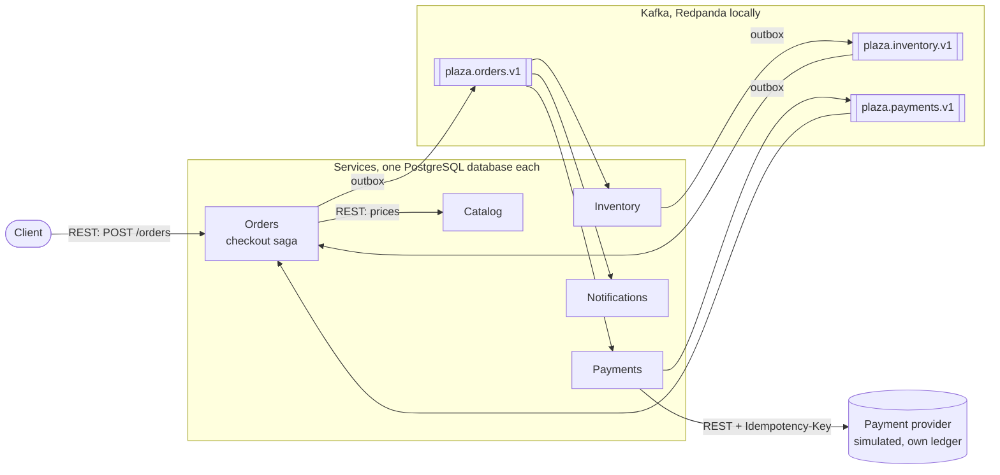
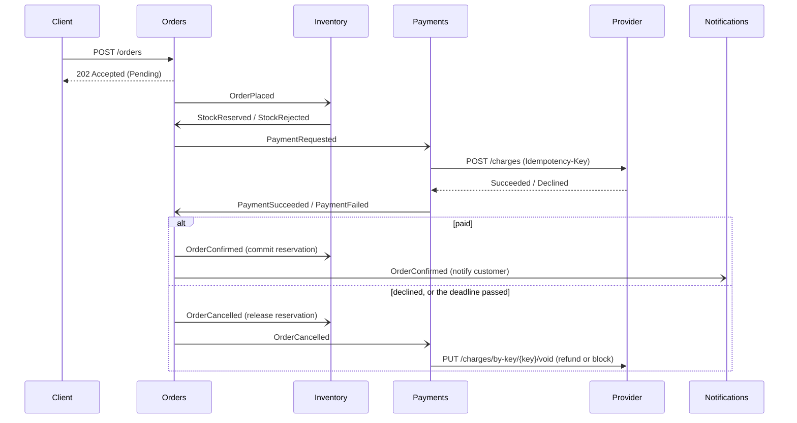

# Plaza

Event-driven e-commerce backend in .NET 10. Five services talk through Kafka with a
transactional outbox and idempotent consumers. The checkout is a saga owned by the Orders
service: when a payment fails or takes too long, the order is cancelled and every service
undoes its part.

The catalogue and all data are invented. Payments go through a simulated provider with opaque
tokens; no card data exists anywhere in the system.

## Results

Every figure below is produced by the test suite. Reproduce with `dotnet test --solution Plaza.slnx`
(needs Docker; containers are started by Testcontainers).

### No order lost, no order charged twice (phase 2)

Money is checked in the payment provider's own ledger and stock in Inventory, never in what
Plaza believes happened. Each test also proves that its fault really occurred.

| Claim | Evidence | How it is measured |
|---|---|---|
| A provider that takes the money but answers too late does not cause a second charge | 3 charge requests reached the provider for one order (2 answered after the caller's timeout); the ledger holds 1 charge, and the order is confirmed | `ChaosTests.Slow_provider_is_retried_with_the_same_key_and_charges_once` |
| An unreliable provider loses no order and double-charges none | 30 orders; 15 charge requests never reached the provider and 15 were processed without the caller getting the answer. Result: 30 confirmed, 30 charges in the ledger (one per order, each for the order's total), stock 100 -> 70 with 0 reserved | `ChaosTests.Unreliable_provider_never_loses_an_order_or_charges_it_twice` |
| A broker restart in the middle of checkouts loses nothing | 10 orders in flight when Redpanda was stopped (at least 1 still unfinished, asserted) and 10 more accepted by the API while it was down, all still `Pending` after 2 s. After the restart: 20 confirmed, 1 charge, 1 payment and 1 notification each, stock 100 -> 80 | `ChaosTests.Broker_restart_in_the_middle_of_checkouts_loses_no_order` |
| A checkout that cannot be paid ends by itself and gives the stock back | Provider down for every attempt: the order is `Expired` at its 6 s deadline (not before), stock back to 10 available / 0 reserved, no charge, and the payment request is on the dead-letter topic | `ExpiryTests.Provider_down_past_the_retry_budget...` |
| Money taken for an order that then expires is returned | Provider charges on every request and never answers in time: the order expires and its single charge ends `Refunded` | `ExpiryTests.Charge_taken_without_an_answer_is_refunded_when_the_order_expires` |
| A declined payment releases its stock, once | Stock back to 10 / 0 after a decline; with every message delivered twice, the unit comes back once (5 / 0) | `CheckoutFlowTests.Declined_payment...`, `DuplicateDeliveryTests` |
| The provider admits one charge per idempotency key | 20 concurrent requests with one key: 1 charge, 20 attempts recorded. Same key with another amount: 422 | `ChargeApiTests` |
| These tests fail when the guarantee is broken | With a new idempotency key per attempt, 5 end-to-end tests fail. With the void sent to the wrong key, the refund test fails | Done by hand on 2026-11-15 by editing `PaymentKeys.ForOrder` and `OrderCancelledHandler`, running the suite and reverting |

### Delivery guarantees (phase 1)

| Claim | Evidence | How it is measured |
|---|---|---|
| No event is published for a rolled-back change, and none is lost when the publisher crashes after the broker acknowledged a batch | The crashed batch is republished (2 copies on the topic, same message id) and applied once | `OutboxTests`, real PostgreSQL + Redpanda |
| A message delivered more than once is applied once | 3 deliveries of one message produce 1 effect and reach the handler 1 time | `ConsumerTests.Message_delivered_twice_is_applied_once` |
| With **every** message in the system delivered twice, no order is charged twice and no stock is reserved twice | 10 orders, 28 distinct messages on the orders topic, each present exactly 2 times; 8 orders paid with exactly 1 payment and 1 provider charge each; stock decreased exactly once per order | `DuplicateDeliveryTests`, all services running |
| Stock is never oversold | 25 concurrent orders for 5 units: 5 confirmed, 20 rejected, 5 payments, stock ends at 0 available / 0 reserved | `CheckoutFlowTests.Concurrent_orders_for_scarce_stock...` |
| | 40 parallel reservations for 5 units at the database level: 5 succeed, 35 are refused | `StockReservationTests.Concurrent_orders_for_the_last_units_never_oversell` |
| A message that cannot be processed does not block its partition and is not dropped | After 4 failed attempts it is on the dead-letter topic with the reason attached, and the next message is processed | `ConsumerTests.Message_that_always_fails...` |
| A trace survives the hop through the outbox and Kafka | The handler's span has the trace id and parent span id of the request that enqueued the message | `ConsumerTests.Handler_runs_in_the_trace...` |

Test suite at the end of phase 2: **131 tests, 0 failures** (69 unit, 18 messaging, 13 inventory,
15 payment provider, 16 end-to-end). Counted by the test runner's summary; one full run took
2 min 18 s on the development laptop, containers included.

There are no latency or throughput numbers yet. They belong to the load-test phase and will be
added here only when measured.

## Architecture



### Checkout flow



```
Pending --StockReserved--> AwaitingPayment --PaymentSucceeded--> Confirmed
   |                              |
   +--StockRejected--> Rejected   +--PaymentFailed--> PaymentFailed --> OrderCancelled
   |                              |
   +------- deadline passed ------+--> Expired --> OrderCancelled
```

### How the guarantees are built

- **Outbox.** A service never writes to Kafka directly. It inserts the message into its own
  `outbox_messages` table in the same transaction as the business change; a background
  publisher sends it and marks it published. Delivery is at-least-once.
- **Inbox.** Each consumer records the message id in `inbox_messages` in the same transaction
  as the handler's changes. A redelivered message finds its id already there and is skipped.
- **Retries and dead-letter topic.** A failing handler is retried in place with exponential
  backoff and jitter, so order per key is kept. After the last attempt the message goes to
  `<topic>.dlt` with the failure reason in headers.
- **Idempotency key.** The inbox cannot protect a call to somebody else's system. Payments
  charges with the key `plaza-order-<order id>`, and the provider stores one outcome per key:
  a charge repeated after a timeout or a crash returns the first outcome and moves no money.
- **Compensation.** When an order cannot complete, Orders publishes `OrderCancelled`.
  Inventory releases the reservation; Payments voids the charge key, which refunds a charge
  that happened and blocks one that has not happened yet.
- **One deadline.** Every order has `expiresAt` (15 minutes by default,
  `Checkout:ReservationTtl`). Orders is the only service with a timer: it expires overdue
  orders and cancels them, so a reservation never outlives its order.
- **Tracing.** The W3C trace context is stored with the outbox row and sent as a Kafka header;
  the consumer continues the trace.

The library behind the first three, [`src/Plaza.Messaging`](src/Plaza.Messaging), is a few
hundred lines and is meant to be read.

## Run it

Requirements: .NET 10 SDK and Docker.

```bash
dotnet run --project src/Plaza.AppHost
```

This starts PostgreSQL, Redpanda, the five services, the simulated payment provider and the
Aspire dashboard (the URL with its login token is printed on start-up). Then place an order:

```bash
curl -i -X POST http://localhost:5103/orders -H "Content-Type: application/json" -d '{"customerId":"3f2504e0-4f89-41d3-9a0c-0305e82c3301","paymentToken":"tok_test_visa","lines":[{"productId":"a0000000-0000-4000-8000-000000000001","quantity":1}]}'
```

Follow the `Location` header to see it move from `Pending` to `Confirmed`. Use the token
`tok_test_declined` to see a payment failure and the stock coming back. Product ids are in
[`seed/products.json`](seed/products.json).

| Service | Local URL | Endpoints |
|---|---|---|
| Catalog | http://localhost:5101 | `GET /products`, `GET /products/{id}`, `GET /products/batch?ids=` |
| Inventory | http://localhost:5102 | `GET /stock/{productId}`, `PUT /stock/{productId}` |
| Orders | http://localhost:5103 | `POST /orders`, `GET /orders/{id}` |
| Payments | http://localhost:5104 | `GET /payments/by-order/{orderId}` |
| Notifications | http://localhost:5105 | `GET /notifications/by-order/{orderId}` |
| Payment provider (simulated) | http://localhost:5106 | `POST /charges`, `PUT /charges/by-key/{key}/void`, `GET /charges/by-key/{key}`, `GET /charges?reference=` |

Every service also exposes `/health/live` and `/health/ready`.

## Test it

```bash
dotnet test --solution Plaza.slnx
```

| Project | What it covers | Needs Docker |
|---|---|---|
| `Plaza.UnitTests` | Order state machine, request validation, charge simulator, message contracts | No |
| `Plaza.Messaging.Tests` | Outbox, inbox, retries, dead-letter topic, trace propagation | Yes |
| `Plaza.Inventory.Tests` | Stock reservation, commit and release under concurrency | Yes |
| `Plaza.PaymentProvider.Tests` | Idempotency keys and voids of the simulated provider | Yes |
| `Plaza.EndToEnd.Tests` | The whole checkout across all services: duplicated delivery, provider faults, deadline, broker restart | Yes |

## Repository layout

```
src/
  Plaza.AppHost          Aspire host for the local environment
  Plaza.ServiceDefaults  OpenTelemetry, health checks, service discovery
  Plaza.Messaging        Outbox, inbox, consumer with retries and dead-letter topic
  Plaza.Contracts        Message types and topic names
  Plaza.Catalog          Products (REST)
  Plaza.Inventory        Stock and reservations
  Plaza.Orders           Order API, checkout saga and deadline
  Plaza.Payments         Charges and voids through the payment provider
  Plaza.PaymentProvider  Simulated external provider with its own ledger
  Plaza.Notifications    Customer notifications (simulated delivery)
tests/                   See "Test it"
docs/adr/                Architecture decision records
seed/                    Invented demo catalogue
```

## Decisions

Each significant decision has a record with the alternatives that were rejected:

| ADR | Decision |
|---|---|
| [0001](docs/adr/0001-monorepo-with-one-project-per-service.md) | Monorepo, five deployable services, one project per service |
| [0002](docs/adr/0002-aspire-for-local-orchestration.md) | .NET Aspire for the local environment only |
| [0003](docs/adr/0003-confluent-kafka-with-own-messaging-library.md) | Confluent.Kafka with a small in-house messaging library |
| [0004](docs/adr/0004-transactional-outbox-with-polling.md) | Transactional outbox published by polling |
| [0005](docs/adr/0005-idempotent-consumers-with-inbox-table.md) | Idempotent consumers with an inbox table |
| [0006](docs/adr/0006-blocking-retries-and-dead-letter-topic.md) | Blocking retries with backoff, then a dead-letter topic |
| [0007](docs/adr/0007-orders-orchestrates-the-checkout.md) | Orders orchestrates the checkout with a persisted state machine |
| [0008](docs/adr/0008-json-messages-with-metadata-in-headers.md) | JSON messages with metadata in Kafka headers |
| [0009](docs/adr/0009-checkout-saga-with-compensations-and-one-deadline.md) | Compensations driven by one cancellation message and one deadline |
| [0010](docs/adr/0010-simulated-payment-provider-with-idempotency-keys.md) | The payment provider is a separate service, called with idempotency keys |
| [0011](docs/adr/0011-chaos-tests-with-injected-faults-and-a-real-broker-restart.md) | Chaos tests with injected provider faults and a real broker restart |

## Security

- **No card data.** The order API accepts only token-shaped values (`tok_...`); a card number is
  rejected by validation. The token is forgotten by Orders once the charge is requested,
  Payments stores only the provider's reference, and the provider stores a hash of the request.
- **One charge per order.** Enforced where the money moves: a unique index on the idempotency
  key in the provider, and a unique index on the order in Payments.
- **Prices are server-side.** Totals are computed from the catalogue, never from the request.
- **Input limits.** Lines per order, quantity per product, page and batch sizes, idempotency
  key and reference lengths are bounded.
- **Database as last line of defence.** Check constraints forbid negative stock and non-positive
  payment amounts.
- **Supply chain.** GitHub Actions are pinned by commit SHA and container images by digest;
  NuGet restores are locked and fail on known-vulnerable packages.

### Known limits of this phase

- **No authentication.** The APIs are open, so anyone who knows an order id can read that order,
  and the stock adjustment endpoint and the simulated provider (charges, voids) are
  unprotected. Authentication is added with the public API; until then this must not be
  exposed outside a development machine.
- **A customer can be charged and then refunded.** If the provider answers after the order's
  deadline, the charge is taken and returned. Between the two there is a short window in which
  money is held for a dead order.
- **A compensation that keeps failing needs a manual replay.** A void that cannot reach the
  provider within the retry budget goes to the dead-letter topic. There is no replay tooling
  and no reconciliation against the provider's ledger yet.
- **One instance of Orders.** Cancelling relies on Orders publishing an order's messages in the
  order it wrote them, which several outbox publishers do not guarantee
  ([ADR 0009](docs/adr/0009-checkout-saga-with-compensations-and-one-deadline.md)).
- **The provider is called inside the consumer's database transaction.** Correct thanks to the
  idempotency key, but a slow provider holds a connection and a partition for the length of
  the HTTP timeout.
- **Published outbox rows and inbox rows are not purged yet**, so those tables grow. Until they
  are, the payment token of an order also remains in the Orders outbox row and on the orders
  topic (it is an opaque provider token, not card data).

## Roadmap

1. **Order flow over Kafka with outbox, idempotent consumers, retries and dead-letter topic** (done)
2. **Checkout saga with compensations, order deadline, payment idempotency keys, chaos tests** (done)
3. AI shopping assistant (Microsoft.Extensions.AI), hybrid search with pgvector, evals in CI, MCP server
4. GraphQL API for clients (Hot Chocolate)
5. Load test with k6, bottlenecks found and fixed
6. Signed images, Kustomize, deployment to kind in CI

## License

[MIT](LICENSE)
