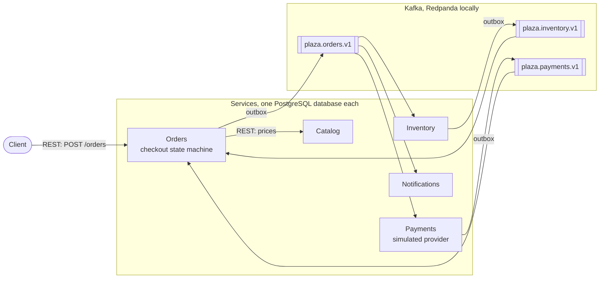
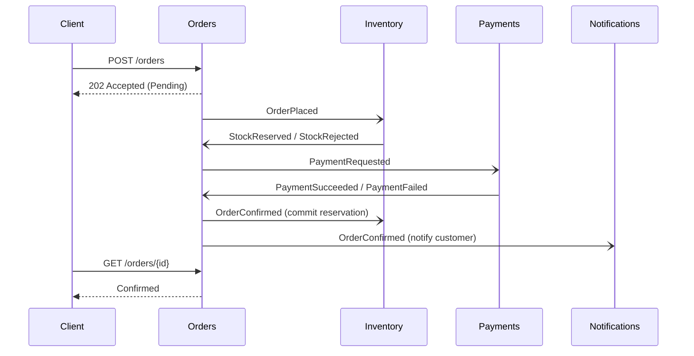

# Plaza

Event-driven e-commerce backend in .NET 10. Five services talk through Kafka with a
transactional outbox and idempotent consumers; the checkout is a state machine owned by the
Orders service.

The catalogue and all data are invented. Payments use a simulated provider and opaque tokens;
no card data exists anywhere in the system.

## Results

Every figure below is produced by the test suite. Reproduce with `dotnet test --solution Plaza.slnx`
(needs Docker; containers are started by Testcontainers).

| Claim | Evidence | How it is measured |
|---|---|---|
| No event is published for a rolled-back change, and none is lost when the publisher crashes after the broker acknowledged a batch | The crashed batch is republished (2 copies on the topic, same message id) and applied once | `OutboxTests`, real PostgreSQL + Redpanda |
| A message delivered more than once is applied once | 3 deliveries of one message produce 1 effect and reach the handler 1 time | `ConsumerTests.Message_delivered_twice_is_applied_once` |
| With **every** message in the system delivered twice, no order is charged twice and no stock is reserved twice | 10 orders, 27 distinct messages on the orders topic, each present exactly 2 times; 8 orders paid with exactly 1 payment each; stock decreased exactly once per order | `DuplicateDeliveryTests`, all five services running |
| Stock is never oversold | 25 concurrent orders for 5 units: 5 confirmed, 20 rejected, 5 payments, stock ends at 0 available / 0 reserved | `CheckoutFlowTests.Concurrent_orders_for_scarce_stock...` |
| | 40 parallel reservations for 5 units at the database level: 5 succeed, 35 are refused | `StockReservationTests.Concurrent_orders_for_the_last_units_never_oversell` |
| A message that cannot be processed does not block its partition and is not dropped | After 4 failed attempts it is on the dead-letter topic with the reason attached, and the next message is processed | `ConsumerTests.Message_that_always_fails...` |
| A trace survives the hop through the outbox and Kafka | The handler's span has the trace id and parent span id of the request that enqueued the message | `ConsumerTests.Handler_runs_in_the_trace...` |

Test suite at the end of phase 1: **93 tests, 0 failures** (57 unit, 18 messaging, 9 inventory,
9 end-to-end). Counted by the test runner's summary; one full run took 33 s on the development
laptop, containers included.

There are no latency or throughput numbers yet. They belong to the load-test phase and will be
added here only when measured.

## Architecture



### Checkout flow



```
Pending --StockReserved--> AwaitingPayment --PaymentSucceeded--> Confirmed
   |                              |
   +--StockRejected--> Rejected   +--PaymentFailed--> PaymentFailed
```

### How delivery guarantees are built

- **Outbox.** A service never writes to Kafka directly. It inserts the message into its own
  `outbox_messages` table in the same transaction as the business change; a background
  publisher sends it and marks it published. Delivery is at-least-once.
- **Inbox.** Each consumer records the message id in `inbox_messages` in the same transaction
  as the handler's changes. A redelivered message finds its id already there and is skipped.
- **Retries and dead-letter topic.** A failing handler is retried in place with exponential
  backoff and jitter, so order per key is kept. After the last attempt the message goes to
  `<topic>.dlt` with the failure reason in headers.
- **Tracing.** The W3C trace context is stored with the outbox row and sent as a Kafka header;
  the consumer continues the trace.

The library that implements this, [`src/Plaza.Messaging`](src/Plaza.Messaging), is a few
hundred lines and is meant to be read.

## Run it

Requirements: .NET 10 SDK and Docker.

```bash
dotnet run --project src/Plaza.AppHost
```

This starts PostgreSQL, Redpanda, the five services and the Aspire dashboard (the URL with its
login token is printed on start-up). Then place an order:

```bash
curl -i -X POST http://localhost:5103/orders -H "Content-Type: application/json" -d '{"customerId":"3f2504e0-4f89-41d3-9a0c-0305e82c3301","paymentToken":"tok_test_visa","lines":[{"productId":"a0000000-0000-4000-8000-000000000001","quantity":1}]}'
```

Follow the `Location` header to see it move from `Pending` to `Confirmed`. Use the token
`tok_test_declined` to see a payment failure. Product ids are in
[`seed/products.json`](seed/products.json).

| Service | Local URL | Endpoints |
|---|---|---|
| Catalog | http://localhost:5101 | `GET /products`, `GET /products/{id}`, `GET /products/batch?ids=` |
| Inventory | http://localhost:5102 | `GET /stock/{productId}`, `PUT /stock/{productId}` |
| Orders | http://localhost:5103 | `POST /orders`, `GET /orders/{id}` |
| Payments | http://localhost:5104 | `GET /payments/by-order/{orderId}` |
| Notifications | http://localhost:5105 | `GET /notifications/by-order/{orderId}` |

Every service also exposes `/health/live` and `/health/ready`.

## Test it

```bash
dotnet test --solution Plaza.slnx
```

| Project | What it covers | Needs Docker |
|---|---|---|
| `Plaza.UnitTests` | Order state machine, request validation, payment provider, message contracts | No |
| `Plaza.Messaging.Tests` | Outbox, inbox, retries, dead-letter topic, trace propagation | Yes |
| `Plaza.Inventory.Tests` | Stock reservation under concurrency | Yes |
| `Plaza.EndToEnd.Tests` | The whole checkout across the five services, including duplicated delivery | Yes |

## Repository layout

```
src/
  Plaza.AppHost          Aspire host for the local environment
  Plaza.ServiceDefaults  OpenTelemetry, health checks, service discovery
  Plaza.Messaging        Outbox, inbox, consumer with retries and dead-letter topic
  Plaza.Contracts        Message types and topic names
  Plaza.Catalog          Products (REST)
  Plaza.Inventory        Stock and reservations
  Plaza.Orders           Order API and checkout state machine
  Plaza.Payments         Charges through a simulated provider
  Plaza.Notifications    Customer notifications (simulated delivery)
tests/                   See "Test it"
docs/adr/                Architecture decision records
seed/                    Invented demo catalogue
```

## Decisions

Each significant decision has a record with the alternatives that were rejected:

| ADR | Decision |
|---|---|
| [0001](docs/adr/0001-monorepo-with-one-project-per-service.md) | Monorepo, five deployable services, one project per service |
| [0002](docs/adr/0002-aspire-for-local-orchestration.md) | .NET Aspire for the local environment only |
| [0003](docs/adr/0003-confluent-kafka-with-own-messaging-library.md) | Confluent.Kafka with a small in-house messaging library |
| [0004](docs/adr/0004-transactional-outbox-with-polling.md) | Transactional outbox published by polling |
| [0005](docs/adr/0005-idempotent-consumers-with-inbox-table.md) | Idempotent consumers with an inbox table |
| [0006](docs/adr/0006-blocking-retries-and-dead-letter-topic.md) | Blocking retries with backoff, then a dead-letter topic |
| [0007](docs/adr/0007-orders-orchestrates-the-checkout.md) | Orders orchestrates the checkout with a persisted state machine |
| [0008](docs/adr/0008-json-messages-with-metadata-in-headers.md) | JSON messages with metadata in Kafka headers |

## Security

- **No card data.** The order API accepts only token-shaped values (`tok_...`); a card number is
  rejected by validation. The token is forgotten by Orders once the charge is requested, and
  Payments stores only the provider's reference.
- **Prices are server-side.** Totals are computed from the catalogue, never from the request.
- **Input limits.** Lines per order, quantity per product, page and batch sizes are bounded.
- **Database as last line of defence.** Check constraints forbid negative stock and non-positive
  amounts; a unique index allows one payment record per order.
- **Supply chain.** GitHub Actions are pinned by commit SHA and container images by digest;
  NuGet restores are locked and fail on known-vulnerable packages.

### Known limits of this phase

- **No authentication.** The APIs are open, so anyone who knows an order id can read that order,
  and the stock adjustment endpoint is unprotected. Authentication is added with the public
  API; until then this must not be exposed outside a development machine.
- **A failed payment leaves its stock reserved.** Releasing it is a compensation, added
  together with reservation expiry in the next phase.
- **Published outbox rows and inbox rows are not purged yet**, so those tables grow. Until they
  are, the payment token of an order also remains in the Orders outbox row and on the orders
  topic (it is an opaque provider token, not card data).
- **Dead-lettered messages need manual replay.** There is no tooling for it yet.

## Roadmap

1. **Order flow over Kafka with outbox, idempotent consumers, retries and dead-letter topic** (done)
2. Checkout saga with compensations, reservation expiry, payment idempotency keys, chaos tests
3. AI shopping assistant (Microsoft.Extensions.AI), hybrid search with pgvector, evals in CI, MCP server
4. GraphQL API for clients (Hot Chocolate)
5. Load test with k6, bottlenecks found and fixed
6. Signed images, Kustomize, deployment to kind in CI

## License

[MIT](LICENSE)
