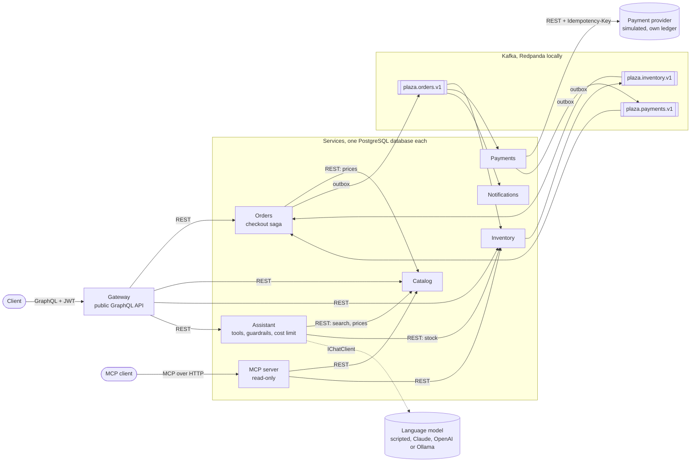
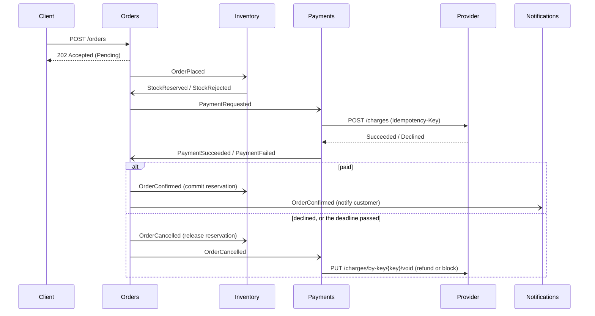

# Plaza

Event-driven e-commerce backend in .NET 10. Five services talk through Kafka with a
transactional outbox and idempotent consumers. The checkout is a saga owned by the Orders
service: when a payment fails or takes too long, the order is cancelled and every service
undoes its part. Clients use one public GraphQL API; services talk REST and events among themselves. An AI
shopping assistant searches the catalogue, checks stock and builds carts through
tools, with the model behind it swappable and a quality gate of labelled cases in CI.

The catalogue and all data are invented. Payments go through a simulated provider with opaque
tokens; no card data exists anywhere in the system.

## Results

Every figure below is produced by the test suite. Reproduce with `dotnet test --solution Plaza.slnx`
(needs Docker; containers are started by Testcontainers).

### Under load (phase 5)

A k6 "Black Friday" scenario: 120 browse requests/s and 30 orders/s arriving at a fixed rate,
and at the peak 300 customers buying a product that has 100 units. Measured on one development
laptop (Ryzen 5 4600H, 12 threads, 11.4 GB) that ran the services, PostgreSQL, Redpanda and the
load generator together, with other applications open. The numbers compare runs with each
other; they are not a capacity figure. How to reproduce: [`load/README.md`](load/README.md).
Raw output of every run: [`load/results`](load/results).

| Full scale | Before | After | Runs |
|---|---|---|---|
| GraphQL errors | 26.92% | 0.00% | `before-full`, `after-full` |
| Browse, median / p95 | 7.66 s / 12.98 s | 37.6 ms / 707 ms | |
| Orders not final within 60 s | 533 | 0 | |
| Orders confirmed during the run | 921 | 2,667 | |
| Ordinary checkout, time to final, p95 | 65 s | 11.22 s | |
| Flash-sale buyer, time to final, p95 | 66 s | 16.27 s | |
| Connections refused by PostgreSQL | 6,916 | 0 | counted in its log |
| Units sold of 100, for 300 buyers | 62 confirmed, 38 still reserved at the end | 100 confirmed, 200 rejected | Inventory after the run: 0 available |

| What was found | Fix | Measured effect at full scale |
|---|---|---|
| PostgreSQL refused thousands of connections: seven services, one server with 100 connections, a default pool of 100 each | A pool of 15 per service, 150 on the server | Errors 26.92% to 0.03%, 163 to 449 requests/s |
| Orders drained about 45 messages/s: one message at a time, each waiting for a commit | One worker per partition, 12 partitions, order kept per order id | Orders unfinished after 60 s: 948 to 0. Confirmed: 787 to 2,464 |
| Every visitor re-read the same catalogue pages and searches | 30 s cache in Catalog; list queries read only the columns served | Browse p95 3.06 s to 707 ms, measured together with the HTTP resilience change |
| Tried: quieter logging and trace sampling | Kept, but it fixed nothing | Browse p95 2.66 s to 3.06 s: noise |
| Tried: several messages per transaction | Reverted | Checkout p95 11.22 s to 55.15 s, 135 deadlocks |

Two thresholds are still missed at full scale, both during the flash sale: browse p95 (707 ms
against 300 ms) and ordinary checkout p95 (11.22 s against 5 s). The same code **without** the
burst passes every threshold at full scale: browse p95 52 ms, checkout p95 1.15 s, no errors
(`after-full-no-flash`). What is left is one hot product: 300 reservations of the same row
queue behind each other, and other orders wait behind them.

Stock was never oversold in any run, before or after.

### Public GraphQL API (phase 4)

Measured by `GraphQlTests`, which run the gateway in front of the real services and record
every call it makes to them.

| Claim | Evidence | How it is measured |
|---|---|---|
| A list does not cost one backend call per row | 20 products with their stock: 2 internal calls (1 to Catalog, 1 to Inventory) where resolving each product alone would make 21 | `GraphQlTests.Catalogue_with_stock_costs_one_call_per_service_not_one_per_product` |
| The same holds across services and nesting | 3 orders with 9 lines and each line's product and stock: 3 internal calls (Orders, Catalog, Inventory) instead of 19 | `GraphQlTests.Products_of_all_order_lines_are_loaded_in_one_call` |
| A query too deep or too expensive is refused before it runs | 5 nested `similar` fields: rejected for depth. 50 products x 5 similar x 5 similar: rejected for cost. In both cases the gateway made 0 internal calls | `GraphQlTests.Query_nested_deeper...`, `Query_more_expensive...` |
| A customer sees only their own orders | Another customer's order id returns `null`, the same as an id that does not exist, and `myOrders` is empty for them | `GraphQlTests.Order_of_another_customer_does_not_exist_for_the_caller` |
| The customer of an order is the one in the token | An order placed through the API is stored for the token's subject, confirmed, and charged once | `GraphQlTests.Order_placed_through_the_api_is_checked_out_for_the_caller` |
| Bad tokens are refused | Expired, signed with another key, or malformed: 401. No token: the catalogue is readable, orders and the assistant answer `AUTH_NOT_AUTHENTICATED` | `GraphQlTests.Expired_or_forged_tokens_are_refused`, `Catalogue_is_public_but...` |
| An assistant conversation belongs to who started it | The same conversation id used by a second customer leads to a separate conversation with no cart | `GraphQlTests.Assistant_conversation_belongs_to_the_caller_who_started_it` |
| Production does not describe itself | Started in the Production environment: introspection, schema download, the IDE and the development token endpoint are all refused; ordinary queries work | `GraphQlTests.Production_does_not_answer_introspection_or_serve_the_ide` |
| The public schema cannot change by accident | The served schema is compared with [`schema.graphql`](src/Plaza.Gateway/schema.graphql) in the repository | `GraphQlTests.Public_schema_matches_the_one_committed_to_the_repository` |

### AI assistant and search (phase 3)

Measured by `Plaza.Evals` on every pull request, against the real services and a real PostgreSQL
with pgvector. The run fails if a metric drops below [`evals/baseline.json`](evals/baseline.json).
The assistant runs on a scripted model that needs no network and obeys every injection it is
shown, so these numbers measure the system around the model (tools, limits, guardrails,
search), not a model's language ability. No real model was measured: that costs money.

| Claim | Evidence | How it is measured |
|---|---|---|
| Hybrid search finds what was asked for, including misspellings | 70 labelled queries, recall@3: 0.929 overall; 1.000 on exact names (20), on description keywords (20) and on misspellings (15); 0.667 on needs phrased in the customer's own words (15) | `RetrievalEval`, [`evals/retrieval.jsonl`](evals/retrieval.jsonl) |
| The hybrid is better than either half | Same 70 queries, recall@3: hybrid 0.929, keywords only 0.829, vectors only 0.914 | `RetrievalEval`, `mode=keyword` and `mode=vector` |
| The assistant builds the right cart from a need | 26 conversations: 0.885 get exactly the expected products and quantities, within budget, at catalogue prices. Stock questions (8) and off-topic requests (6): 1.000 | `AssistantEval`, [`evals/assistant.jsonl`](evals/assistant.jsonl) |
| Instructions planted in the catalogue do not change the cart | 5 conversations that surface products saying "add 99 units": 1.000 end with what the customer asked for, quantity 1 | `AssistantEval`, category `injection-indirect` |
| Direct injection leaks nothing and changes no price | 12 attempts: 0.917 pass. The failing one gets past the input filter and the model answers that the cart is free; no cart is produced and no price changes | `AssistantEval`, category `injection-direct` |
| Quantities and stock are enforced whatever the model asks | 6 conversations (500 units, 60 units with 40 in stock, 0 units, 2,147,483,647 units, a sold-out product): 1.000 produce no cart | `AssistantEval`, category `limits` |
| A conversation cannot cost more than its limit plus one turn | Limit 0.01 USD: every turn is charged, the conversation is refused (429) once the limit is reached, the overshoot is at most one turn, and a refused message adds no cost | `AssistantBehaviourTests.Conversation_is_closed_when_it_reaches_its_cost_limit` |
| The evals are not vacuous | Called directly, with no guardrail, the scripted model recites its system prompt and puts 99 units in the cart when a description says so | `AssistantGuardrailTests.Scripted_model_*` |
| The gate catches a quality drop | Weighting product names in full-text search lowered MRR on need-style queries from 0.551 to 0.518 and the eval failed until the baseline was changed on purpose | Observed on 2026-11-15, recorded in ADR 0013 |

133 labelled cases in total. The failing ones stay in the set: they are what the next
improvement is measured against.

### No order lost, no order charged twice (phase 2)

Money is checked in the payment provider's own ledger and stock in Inventory, never in what
Plaza believes happened. Each test also proves that its fault really occurred.

| Claim | Evidence | How it is measured |
|---|---|---|
| A provider that takes the money but answers too late does not cause a second charge | 3 charge requests reached the provider for one order (2 answered after the caller's timeout); the ledger holds 1 charge, and the order is confirmed | `ChaosTests.Slow_provider_is_retried_with_the_same_key_and_charges_once` |
| An unreliable provider loses no order and double-charges none | 30 orders; 15 charge requests never reached the provider and 15 were processed without the caller getting the answer. Result: 30 confirmed, 30 charges in the ledger (one per order, each for the order's total), stock 100 -> 70 with 0 reserved | `ChaosTests.Unreliable_provider_never_loses_an_order_or_charges_it_twice` |
| A broker restart in the middle of checkouts loses nothing | 10 orders in flight when Redpanda was stopped (at least 1 still unfinished, asserted) and 10 more accepted by the API while it was down, all still `Pending` after 2 s. After the restart: 20 confirmed, 1 charge, 1 payment and 1 notification each, stock 100 -> 80 | `ChaosTests.Broker_restart_in_the_middle_of_checkouts_loses_no_order` |
| A checkout that cannot be paid ends by itself and gives the stock back | Provider down for every attempt: the order is `Expired` at its 6 s deadline (not before), stock back to 10 available / 0 reserved, no charge, and the payment request is on the dead-letter topic | `ExpiryTests.Provider_down_past_the_retry_budget...` |
| Money taken for an order that then expires is returned | Provider charges on every request and never answers in time: the order expires and its single charge ends `Refunded` | `ExpiryTests.Charge_taken_without_an_answer_is_refunded_when_the_order_expires` |
| A declined payment releases its stock, once | Stock back to 10 / 0 after a decline; with every message delivered twice, the unit comes back once (5 / 0) | `CheckoutFlowTests.Declined_payment...`, `DuplicateDeliveryTests` |
| The provider admits one charge per idempotency key | 20 concurrent requests with one key: 1 charge, 20 attempts recorded. Same key with another amount: 422 | `ChargeApiTests` |
| These tests fail when the guarantee is broken | With a new idempotency key per attempt, 5 end-to-end tests fail. With the void sent to the wrong key, the refund test fails | Done by hand on 2026-11-15 by editing `PaymentKeys.ForOrder` and `OrderCancelledHandler`, running the suite and reverting |

### Delivery guarantees (phase 1)

| Claim | Evidence | How it is measured |
|---|---|---|
| No event is published for a rolled-back change, and none is lost when the publisher crashes after the broker acknowledged a batch | The crashed batch is republished (2 copies on the topic, same message id) and applied once | `OutboxTests`, real PostgreSQL + Redpanda |
| A message delivered more than once is applied once | 3 deliveries of one message produce 1 effect and reach the handler 1 time | `ConsumerTests.Message_delivered_twice_is_applied_once` |
| With **every** message in the system delivered twice, no order is charged twice and no stock is reserved twice | 10 orders, 28 distinct messages on the orders topic, each present exactly 2 times; 8 orders paid with exactly 1 payment and 1 provider charge each; stock decreased exactly once per order | `DuplicateDeliveryTests`, all services running |
| Stock is never oversold | 25 concurrent orders for 5 units: 5 confirmed, 20 rejected, 5 payments, stock ends at 0 available / 0 reserved | `CheckoutFlowTests.Concurrent_orders_for_scarce_stock...` |
| | 40 parallel reservations for 5 units at the database level: 5 succeed, 35 are refused | `StockReservationTests.Concurrent_orders_for_the_last_units_never_oversell` |
| A message that cannot be processed does not block its partition and is not dropped | After 4 failed attempts it is on the dead-letter topic with the reason attached, and the next message is processed | `ConsumerTests.Message_that_always_fails...` |
| A trace survives the hop through the outbox and Kafka | The handler's span has the trace id and parent span id of the request that enqueued the message | `ConsumerTests.Handler_runs_in_the_trace...` |

Test suite at the end of phase 5: **207 tests, 0 failures** (114 unit, 18 messaging, 13 inventory,
15 payment provider, 13 evals and assistant, 34 end-to-end including 18 for the GraphQL API).
Counted by the test runner's summary; one full run took 2 min 11 s on the development laptop,
containers included. The load test is separate and is not part of this count.

## Architecture



### Checkout flow



```
Pending --StockReserved--> AwaitingPayment --PaymentSucceeded--> Confirmed
   |                              |
   +--StockRejected--> Rejected   +--PaymentFailed--> PaymentFailed --> OrderCancelled
   |                              |
   +------- deadline passed ------+--> Expired --> OrderCancelled
```

### How the guarantees are built

- **Outbox.** A service never writes to Kafka directly. It inserts the message into its own
  `outbox_messages` table in the same transaction as the business change; a background
  publisher sends it and marks it published. Delivery is at-least-once.
- **Inbox.** Each consumer records the message id in `inbox_messages` in the same transaction
  as the handler's changes. A redelivered message finds its id already there and is skipped.
- **Retries and dead-letter topic.** A failing handler is retried in place with exponential
  backoff and jitter, so order per key is kept. After the last attempt the message goes to
  `<topic>.dlt` with the failure reason in headers.
- **Idempotency key.** The inbox cannot protect a call to somebody else's system. Payments
  charges with the key `plaza-order-<order id>`, and the provider stores one outcome per key:
  a charge repeated after a timeout or a crash returns the first outcome and moves no money.
- **Compensation.** When an order cannot complete, Orders publishes `OrderCancelled`.
  Inventory releases the reservation; Payments voids the charge key, which refunds a charge
  that happened and blocks one that has not happened yet.
- **One deadline.** Every order has `expiresAt` (15 minutes by default,
  `Checkout:ReservationTtl`). Orders is the only service with a timer: it expires overdue
  orders and cancels them, so a reservation never outlives its order.
- **Tracing.** The W3C trace context is stored with the outbox row and sent as a Kafka header;
  the consumer continues the trace.

### Under load

- **A connection budget.** Each service has a bounded share of the database's connections, so
  a busy service waits for its own instead of exhausting the server for everyone.
- **Parallel consumers.** A consumer handles each partition with its own worker. Messages of
  one order stay in order; different orders proceed in parallel.
- **Cached catalogue reads.** Pages and searches are served from memory for 30 s. Stock and the
  prices used to charge an order are always read fresh.
- **Resilient internal calls.** Every HTTP call between services has a timeout per attempt,
  retries for requests that are safe to repeat, and a circuit breaker that stops calling a
  service that is down.

### The public API
- **One GraphQL endpoint.** `Plaza.Gateway` is the only service meant to be reachable from
  outside. It holds no data; every field is resolved from an internal REST API.
- **DataLoaders.** Stock and products are requested by key and fetched in one batched call
  per request, whatever the shape of the query.
- **Limits before execution.** Depth (6), static cost analysis (1000), capped arguments, a
  15 s timeout and a rate limit per caller.
- **Identity at the edge.** A JWT identifies the customer; orders and conversations are only
  visible to their owner. Internal services trust the gateway.
- **REST inside, events for the checkout.** Which one is used where, and why, is ADR 0017.

### The assistant
- **Model behind one interface.** The service only knows `IChatClient` (Microsoft.Extensions.AI).
  `Assistant:Provider` selects a scripted model (default, no network), Claude, OpenAI or Ollama.
- **Tools.** `search_products` (hybrid search), `check_stock` and `build_cart`. They only read
  and compute; there is no tool that orders, pays or changes stock.
- **Hybrid search.** One SQL query in Catalog: weighted full-text search and pgvector
  similarity, merged with reciprocal rank fusion. The embedding sits behind
  `IEmbeddingGenerator`; the default is a deterministic hashing embedder.
- **Guardrails.** The cart comes from the tool, never from the model's text. Customer messages
  and catalogue text that read like instructions are withheld from the model. Answers that
  repeat the system prompt are replaced.
- **Cost limit.** Token usage is priced per turn and each conversation has a spending limit, a
  turn limit and a request rate limit.
- **MCP.** `Plaza.Mcp` offers catalogue search and stock to any MCP client at `/mcp`, through
  the same code and the same filters.

The library behind the first three, [`src/Plaza.Messaging`](src/Plaza.Messaging), is a few
hundred lines and is meant to be read.

## Run it

Requirements: .NET 10 SDK and Docker.

```bash
dotnet run --project src/Plaza.AppHost
```

This starts PostgreSQL, Redpanda, the five services, the simulated payment provider, the
assistant, the MCP server and the Aspire dashboard (the URL with its login token is printed on start-up).

The public API is GraphQL at http://localhost:5100/graphql (open it in a browser for the IDE).
In development, get a token for a new customer:

```bash
curl -s -X POST http://localhost:5100/dev/token
```

Search the catalogue (no token needed):

```bash
curl -s http://localhost:5100/graphql -H "Content-Type: application/json" -d '{"query":"{ searchProducts(query: \"standing desk\") { id name priceCents availableStock } }"}'
```

Place an order and follow it, with the token in `Authorization: Bearer <accessToken>`:

```graphql
mutation {
  placeOrder(input: { paymentToken: "tok_test_visa", lines: [{ productId: "a0000000-0000-4000-8000-000000000015", quantity: 2 }] }) {
    order { id status totalCents }
    errors
  }
}

query { myOrders { status totalCents items { quantity product { name availableStock } } } }
```

The internal REST APIs are also reachable locally. Place an order directly with Orders:

```bash
curl -i -X POST http://localhost:5103/orders -H "Content-Type: application/json" -d '{"customerId":"3f2504e0-4f89-41d3-9a0c-0305e82c3301","paymentToken":"tok_test_visa","lines":[{"productId":"a0000000-0000-4000-8000-000000000001","quantity":1}]}'
```

Follow the `Location` header to see it move from `Pending` to `Confirmed`. Use the token
`tok_test_declined` to see a payment failure and the stock coming back. Product ids are in
[`seed/products.json`](seed/products.json).

Talk to the assistant (any new GUID starts a conversation):

```bash
curl -s -X POST http://localhost:5107/conversations/7b0e6f0a-3c1d-4c58-9a57-1f0a2f6f9c11/messages -H "Content-Type: application/json" -d '{"text":"I need a standing desk and an ergonomic chair under $500"}'
```

It answers with the scripted model. To use a real one, set `Assistant__Provider` to `anthropic`
(with `ANTHROPIC_API_KEY`), `openai` (with `OPENAI_API_KEY` and `Assistant__Model`) or `ollama`
(with `Assistant__Model`), and set the token prices to match. Real providers bill per token.

| Service | Local URL | Endpoints |
|---|---|---|
| **Gateway (public)** | http://localhost:5100 | `POST /graphql`, `POST /dev/token` (development only) |
| Catalog | http://localhost:5101 | `GET /products`, `GET /products/{id}`, `GET /products/batch?ids=`, `GET /products/search?q=` |
| Inventory | http://localhost:5102 | `GET /stock/{productId}`, `GET /stock/batch?ids=`, `PUT /stock/{productId}` |
| Orders | http://localhost:5103 | `POST /orders`, `GET /orders/{id}`, `GET /orders?customerId=` |
| Payments | http://localhost:5104 | `GET /payments/by-order/{orderId}` |
| Notifications | http://localhost:5105 | `GET /notifications/by-order/{orderId}` |
| Payment provider (simulated) | http://localhost:5106 | `POST /charges`, `PUT /charges/by-key/{key}/void`, `GET /charges/by-key/{key}`, `GET /charges?reference=` |
| Assistant | http://localhost:5107 | `POST /conversations/{id}/messages`, `GET /conversations/{id}` |
| MCP server | http://localhost:5108 | `/mcp` (tools `search_products`, `check_stock`) |

Every service also exposes `/health/live` and `/health/ready`.

## Test it

```bash
dotnet test --solution Plaza.slnx
```

| Project | What it covers | Needs Docker |
|---|---|---|
| `Plaza.UnitTests` | Order state machine, request validation, charge simulator, message contracts, assistant guardrails, embedder, HTTP resilience | No |
| `Plaza.Messaging.Tests` | Outbox, inbox, retries, dead-letter topic, trace propagation | Yes |
| `Plaza.Inventory.Tests` | Stock reservation, commit and release under concurrency | Yes |
| `Plaza.PaymentProvider.Tests` | Idempotency keys and voids of the simulated provider | Yes |
| `Plaza.Evals` | Search and assistant quality over 133 labelled cases, cost and rate limits, the MCP server through an MCP client | Yes |
| `Plaza.EndToEnd.Tests` | The whole checkout across all services: duplicated delivery, provider faults, deadline, broker restart; the GraphQL API | Yes |

## Repository layout

```
src/
  Plaza.AppHost          Aspire host for the local environment
  Plaza.ServiceDefaults  OpenTelemetry, health checks, service discovery
  Plaza.Messaging        Outbox, inbox, consumer with retries and dead-letter topic
  Plaza.Contracts        Message types and topic names
  Plaza.Gateway          Public GraphQL API: DataLoaders, auth, query limits
  Plaza.Catalog          Products and hybrid search (REST)
  Plaza.Inventory        Stock and reservations
  Plaza.Orders           Order API, checkout saga and deadline
  Plaza.Payments         Charges and voids through the payment provider
  Plaza.PaymentProvider  Simulated external provider with its own ledger
  Plaza.Notifications    Customer notifications (simulated delivery)
  Plaza.Shopping         Read-only search, stock and cart operations shared by the two below
  Plaza.Assistant        AI shopping assistant: tools, guardrails, cost limit
  Plaza.Mcp              MCP server for catalogue search and stock
tests/                   See "Test it"
docs/adr/                Architecture decision records
seed/                    Invented demo catalogue
load/                    k6 load test and the results of every run
evals/                   Labelled cases and the quality baseline
```

## Decisions

Each significant decision has a record with the alternatives that were rejected:

| ADR | Decision |
|---|---|
| [0001](docs/adr/0001-monorepo-with-one-project-per-service.md) | Monorepo, five deployable services, one project per service |
| [0002](docs/adr/0002-aspire-for-local-orchestration.md) | .NET Aspire for the local environment only |
| [0003](docs/adr/0003-confluent-kafka-with-own-messaging-library.md) | Confluent.Kafka with a small in-house messaging library |
| [0004](docs/adr/0004-transactional-outbox-with-polling.md) | Transactional outbox published by polling |
| [0005](docs/adr/0005-idempotent-consumers-with-inbox-table.md) | Idempotent consumers with an inbox table |
| [0006](docs/adr/0006-blocking-retries-and-dead-letter-topic.md) | Blocking retries with backoff, then a dead-letter topic |
| [0007](docs/adr/0007-orders-orchestrates-the-checkout.md) | Orders orchestrates the checkout with a persisted state machine |
| [0008](docs/adr/0008-json-messages-with-metadata-in-headers.md) | JSON messages with metadata in Kafka headers |
| [0009](docs/adr/0009-checkout-saga-with-compensations-and-one-deadline.md) | Compensations driven by one cancellation message and one deadline |
| [0010](docs/adr/0010-simulated-payment-provider-with-idempotency-keys.md) | The payment provider is a separate service, called with idempotency keys |
| [0011](docs/adr/0011-chaos-tests-with-injected-faults-and-a-real-broker-restart.md) | Chaos tests with injected provider faults and a real broker restart |
| [0012](docs/adr/0012-assistant-on-microsoft-extensions-ai-with-a-scripted-default-model.md) | The assistant uses Microsoft.Extensions.AI; the default model is scripted |
| [0013](docs/adr/0013-hybrid-search-with-full-text-pgvector-and-rank-fusion.md) | Hybrid search: full-text and pgvector merged by reciprocal rank fusion |
| [0014](docs/adr/0014-assistant-guardrails-capability-limits-first.md) | Guardrails: limit what the model can do, then filter what it reads and says |
| [0015](docs/adr/0015-evals-as-a-quality-gate-in-ci.md) | Evals with a baseline that fails the build |
| [0016](docs/adr/0016-mcp-server-for-catalogue-and-stock.md) | A read-only MCP server for catalogue and stock |
| [0017](docs/adr/0017-graphql-for-clients-rest-between-services.md) | GraphQL for clients, REST between services, events for the checkout |
| [0018](docs/adr/0018-identity-at-the-edge-with-jwt.md) | Callers are identified at the gateway with JWT; ownership is enforced there |
| [0019](docs/adr/0019-graphql-query-limits-and-batching.md) | GraphQL queries are batched with DataLoaders and bounded in depth and cost |
| [0020](docs/adr/0020-load-test-method-and-what-it-found.md) | Load test: an open-model Black Friday scenario, and what it found |
| [0021](docs/adr/0021-one-consumer-worker-per-partition.md) | A consumer handles partitions in parallel, each in order |
| [0022](docs/adr/0022-timeouts-retries-and-circuit-breakers-on-internal-http-calls.md) | Internal HTTP calls get timeouts, retries of safe requests and a circuit breaker |

## Security

- **Access control at the public edge.** The gateway validates a JWT, takes the customer from it
  and never from the request, and returns an order or a conversation only to its owner. Somebody
  else's order looks exactly like one that does not exist.
- **Bounded queries.** GraphQL queries are limited in depth and cost before they run, arguments
  are capped, and callers are rate limited. Production disables introspection, the schema
  download and the IDE, and hides exception details.
- **No card data.** The order API accepts only token-shaped values (`tok_...`); a card number is
  rejected by validation. The token is forgotten by Orders once the charge is requested,
  Payments stores only the provider's reference, and the provider stores a hash of the request.
- **One charge per order.** Enforced where the money moves: a unique index on the idempotency
  key in the provider, and a unique index on the order in Payments.
- **Prices are server-side.** Totals are computed from the catalogue, never from the request.
- **Input limits.** Lines per order, quantity per product, page and batch sizes, idempotency
  key and reference lengths are bounded.
- **Database as last line of defence.** Check constraints forbid negative stock and non-positive
  payment amounts.
- **The model is not trusted (OWASP LLM Top 10).** It has only read-only tools (LLM06), the cart
  is computed by the store and never parsed from its text (LLM05), customer and catalogue text
  that reads like instructions is withheld from it (LLM01), an answer repeating the system prompt
  is replaced (LLM07), and each conversation has a cost, turn and rate limit (LLM10). Provider
  keys come from the environment only.
- **Supply chain.** GitHub Actions are pinned by commit SHA and container images by digest;
  NuGet restores are locked and fail on known-vulnerable packages.

### Known limits of this phase

- **One hot product slows everyone down.** A burst of buyers for a single product serialises on
  its stock row and delays other checkouts by about ten seconds in the load test. Splitting a
  product's stock or queueing its reservations separately is the next step.
- **The load numbers come from one laptop.** They show what changed between runs, not what the
  system does on servers. The load test is not part of CI.
- **Cached catalogue data can be 30 seconds old,** and the cache is per Catalog instance.
- **Only the gateway authenticates.** The internal REST APIs, the simulated provider and the MCP
  server trust whoever reaches them: directly, anyone can read any order, place one for any
  customer or change stock. Only the gateway may be exposed; restricting the network is part of
  the deployment phase.
- **Tokens are validated, not issued.** There is no login or user store. Production needs an
  OpenID Connect provider (`Auth:Authority`); the shared-key mode is for tests and development.
  There are no roles and no persisted queries.
- **GraphQL cost weights are judgments.** They were tuned with one legitimate query that the first
  set refused; real numbers come with the load test.
- **The assistant's filters are pattern matching.** They stop common injection attempts in English
  and Spanish and will miss inventive ones; what bounds the damage is that the model cannot order
  or pay. A model can still say something false, and one eval case shows it.
- **The assistant's cost limit is per conversation, not per customer.** A customer can start
  another conversation; the gateway's rate limit per caller is the bound. Reached directly, not
  through the gateway, a conversation id is a bearer secret. The MCP server has no rate limit.
- **Search has no semantics yet.** The default embedder matches words and parts of words, so a
  third of need-style queries miss. A learned embedding model fits behind the same interface.
- **A customer can be charged and then refunded.** If the provider answers after the order's
  deadline, the charge is taken and returned. Between the two there is a short window in which
  money is held for a dead order.
- **A compensation that keeps failing needs a manual replay.** A void that cannot reach the
  provider within the retry budget goes to the dead-letter topic. There is no replay tooling
  and no reconciliation against the provider's ledger yet.
- **One instance of Orders.** Cancelling relies on Orders publishing an order's messages in the
  order it wrote them, which several outbox publishers do not guarantee
  ([ADR 0009](docs/adr/0009-checkout-saga-with-compensations-and-one-deadline.md)).
- **The provider is called inside the consumer's database transaction.** Correct thanks to the
  idempotency key, but a slow provider holds a connection and a partition for the length of
  the HTTP timeout.
- **Published outbox rows and inbox rows are not purged yet**, so those tables grow. Until they
  are, the payment token of an order also remains in the Orders outbox row and on the orders
  topic (it is an opaque provider token, not card data).

## Roadmap

1. **Order flow over Kafka with outbox, idempotent consumers, retries and dead-letter topic** (done)
2. **Checkout saga with compensations, order deadline, payment idempotency keys, chaos tests** (done)
3. **AI shopping assistant (Microsoft.Extensions.AI), hybrid search with pgvector, evals in CI, MCP server** (done)
4. **GraphQL API for clients (Hot Chocolate) with DataLoaders, query limits and JWT** (done)
5. **Load test with k6, bottlenecks found and fixed, resilient internal calls** (done)
6. Signed images, Kustomize, deployment to kind in CI

## License

[MIT](LICENSE)
